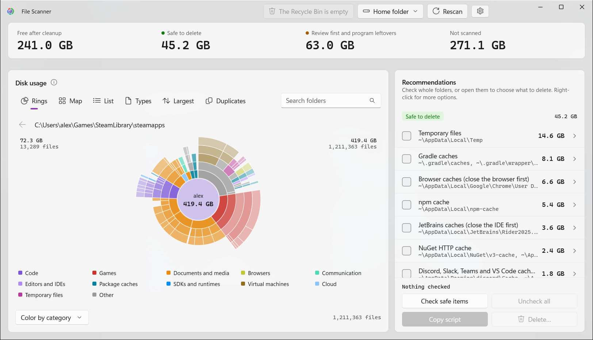

[English](README.md) · Español

# File Scanner

Es una app de Windows que muestra qué ocupa espacio en tu carpeta personal y elimina las cachés, archivos temporales, volcados de memoria y carpetas `node_modules` antiguas que marques.

Guía paso a paso: [Cómo usar File Scanner](docs/how-to-use-es_ES.md).

La app se abre en inglés. Para pasarla a español, haz clic en el engranaje (*Settings*) de la barra de título, elige *Español* en *Language* y haz clic en *Restart now*.

<picture>
  <source media="(prefers-color-scheme: dark)" srcset="docs/rings.png">
  <source media="(prefers-color-scheme: light)" srcset="docs/rings-light.png">
  
</picture>

En un Core i9-13900K con un SSD NVMe (Samsung 980 PRO) escanea 2 millones de archivos (365 GB) en unos 5 segundos. Los archivos comprimidos, sparse y solo en la nube cuentan por su tamaño en disco, no por el declarado.

## Funciones

- Vistas de anillos, mapa y lista, coloreadas por categoría o por antigüedad, con búsqueda de carpetas (Ctrl+F).
- Recomendaciones de limpieza: *Seguro para eliminar*, *Revisar primero* y *Posibles restos de programas*.
- Enviar a la Papelera de reciclaje, eliminar definitivamente o copiar un script de PowerShell para ejecutarlo tú.
- Espacio por tipo de archivo, los 100 archivos más grandes y archivos duplicados.
- Inglés o español, tema claro u oscuro.

## Instalación

Descarga `FileScanner-Setup-x.y.z.exe` desde [Releases](https://github.com/javiergg89/file-scanner/releases/latest) y ejecútalo. Por defecto se instala para el usuario actual, sin permisos de administrador. Necesita Windows 10 versión 2004 o posterior, x64. Incluye los runtimes de .NET y de Windows App SDK; no hace falta instalar nada más.

Alternativa portable: `FileScanner-x.y.z-portable.exe` es la app entera en un solo archivo, sin instalador ni carpeta. Ponlo donde quieras y ejecútalo. No añade entrada en el menú Inicio ni en el menú contextual del Explorador, y la primera vez tarda un poco más en arrancar (se descomprime en una carpeta temporal).

El instalador no tiene firma de código, así que SmartScreen puede bloquear la primera ejecución. Elige *Más información* y luego *Ejecutar de todas formas*. Para comprobar que lo generó el workflow de release de este repositorio, ejecuta `gh attestation verify FileScanner-Setup-x.y.z.exe -R javiergg89/file-scanner`.

## Desarrollo

Necesita el [SDK de .NET 10](https://dotnet.microsoft.com/download); [`global.json`](global.json) fija la versión. Los paquetes vienen solo de nuget.org y los fija `packages.lock.json`.

```powershell
dotnet build FileScanner.slnx
dotnet run --project FileScanner.Check    # checks de Core
dotnet run --project FileScanner          # la app
```

`FileScanner.Check` también admite `bench`, `leftovers` y `duplicates` (ejecútalo con `-c Release -- <name>`). La app admite `--demo` para mostrar datos inventados al hacer capturas de pantalla.

`FileScanner/Core` tiene el escáner, la disposición del gráfico y las reglas de limpieza, sin código de interfaz. `install` tiene el script de Inno Setup.

## Release

Aumenta `<Version>` en [`Directory.Build.props`](Directory.Build.props) y haz push a `main`. El [workflow `Release`](.github/workflows/release.yml) ejecuta los checks, genera el instalador, pone un tag al commit (`vX.Y.Z`) y publica una release en GitHub. El [workflow `CI`](.github/workflows/ci.yml) ejecuta los checks en los pull requests a `main`.

Para generar el instalador en local también necesitas [Inno Setup 6](https://jrsoftware.org/isinfo.php):

```powershell
dotnet publish FileScanner\FileScanner.csproj -c Release -o publish -p:Version=X.Y.Z
install\build-installer.ps1 -Version X.Y.Z
```

El instalador queda en `dist\`.

## Licencia

El código fuente está bajo la [licencia MIT](LICENSE). El instalador también contiene el runtime de .NET (MIT) y el de Windows App SDK, bajo las condiciones de Microsoft; consulta [THIRD-PARTY-NOTICES.md](THIRD-PARTY-NOTICES.md).

## Seguridad y privacidad

La app no se conecta a la red. Lee las carpetas que eliges escanear y la lista de programas instalados del registro de Windows, y elimina solo lo que marcas.

Guarda sus datos en `%LOCALAPPDATA%\FileScanner` ([detalles](docs/how-to-use-es_ES.md#archivos-que-guarda-la-app)).

Informa de vulnerabilidades como se explica en [SECURITY.md](SECURITY.md).
